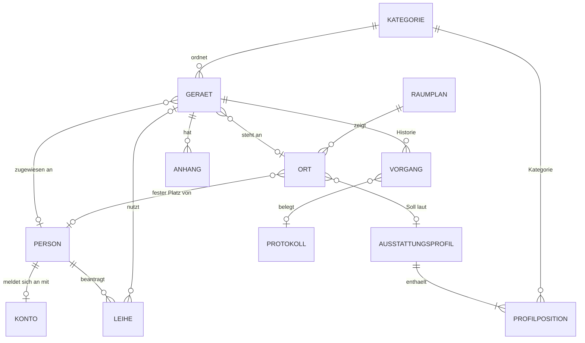
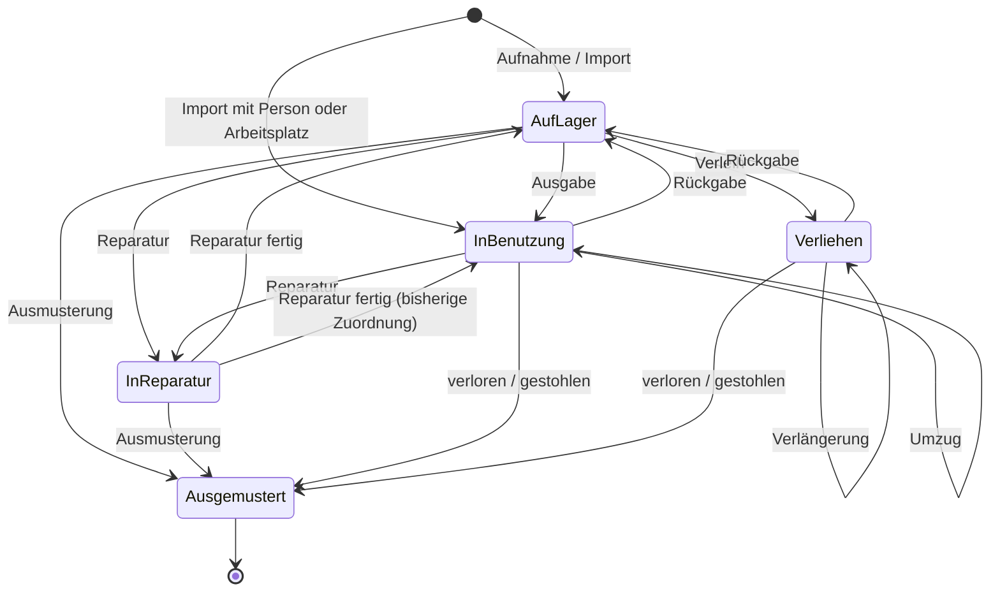

# WMC Inventar: Anforderungen an die Hardware-Verwaltung

| | |
|---|---|
| Version | 0.5 (Stand für die Umsetzung; Raumplan nach dem Fluchtplan, IDs N-01 bis N-11 für Kapitel 7) |
| Datum | 22.10.2026 |
| Verantwortlich | Erwin Moretz, IT |
| Mockup | Claude Design: [WMC Inventar Mockup](https://claude.ai/artifact/JsCkL37DMg5Vi3tsDXY8cq); klickbarer Prototyp: `mockup/wmc-inventar-prototyp.html`, online [WMC Inventar Prototyp](https://claude.ai/artifact/VNqKqetybNXhGuMwrCm3kv) |
| Protokollvorlagen | WMC-IT-FRM-001 Ausgabeprotokoll v1.1, WMC-IT-FRM-002 Rücknahmeprotokoll v1.1. Aufbau und Wortlaut ohne Personendaten in `docs/vorlagen/FRM-001.md` und `FRM-002.md`; die Beispiel-PDFs enthalten Personendaten und gehören nicht ins Repository. |
| Bestandsliste | `WMC_Hardwarebestand.xlsx`, aktuelles Arbeitsdokument der IT (Blatt Inventar zuletzt am 18.06.2024 geändert, Blatt Notebooks am 08.10.2024). Enthält Namen von Mitarbeitern und gehört nicht ins Repository; für Tests liegt eine anonymisierte Fassung mit gleichem Aufbau in `docs/vorlagen/bestandsliste_anonymisiert.xlsx`. Befund in Kapitel 5.10. |
| Jira | Epic WMCNL-2755 im Projekt Next Level; je Meilenstein eine Story (WMCNL-2756 bis -2762), offene Punkte unter WMCNL-2763 |
| Umsetzung | Gregor (KI-Mitarbeiter Entwicklung), Tests mit Robot Framework: Theo (KI-Mitarbeiter Test), Abnahme: Erwin Moretz; Auftrag in `docs/AUFTRAG.md` und `docs/TESTAUFTRAG.md` |
| Arbeitstitel | WMC Inventar |

## 1 Zweck und Ziele

WAMOCON verwaltet die Bürohardware künftig in einem eigenen Web-Tool. Es löst die bisherige Inventarliste ab. Jedes Gerät hat eine Inventarnummer, einen Status und einen Verbleib (Person, Arbeitsplatz oder Lager). Jede Bewegung wird mit Datum und handelnder Person festgehalten.

Das Tool gilt als erfolgreich, wenn diese Ziele erreicht sind:

| Nr. | Ziel |
|---|---|
| Z1 | Für jedes Gerät ist jederzeit sichtbar, wo es ist und wer es hat. |
| Z2 | Jede Ausgabe und Rückgabe an Personen ist mit einem digital signierten Protokoll nach Vorlage belegt, das beide Seiten per Mail erhalten haben. |
| Z3 | Beim Austritt einer Person zeigt das Tool vollständig, welche Geräte zurückkommen müssen. |
| Z4 | Für jeden Arbeitsplatz ist erkennbar, ob die Soll-Ausstattung vollständig ist. |
| Z5 | Jedes ausgemusterte Gerät mit Datenträger hat einen Löschnachweis. |

### 1.1 Bezug zum Marktstandard

Der Prozess folgt dem Lebenszyklus der ITIL-4-Praxis „IT Asset Management“: Aufnahme, Ausgabe, Betrieb, Rückgabe, Ausmusterung. Der Umfang entspricht der ersten Einführungsstufe „Trustworthy Data“ aus ISO/IEC 19770-1:2017 (Anhang B): erst verlässliche Bestandsdaten, Automatisierung später.

Das Tool liefert außerdem Nachweise für drei Maßnahmen aus ISO/IEC 27001:2022, Anhang A: 5.9 (Inventar der Werte), 5.11 (Rückgabe von Werten) und 7.14 (sichere Entsorgung oder Wiederverwendung von Geräten). Für die Datenlöschung vor der Entsorgung ist NIST SP 800-88 der Maßstab.

Quellen: [ITIL 4 Practitioner: IT Asset Management (Axelos)](https://www.axelos.com/certifications/itil-service-management/itil-practices-manager/itil-4-specialist-plan-implement-and-control/itil-4-practitioner-it-asset-management) · [ISO/IEC 19770-1:2017 (ISO JTC1/SC7)](https://committee.iso.org/sites/jtc1sc7/home/projects/flagship-standards/isoiec-19770-12017.html) · [IT Asset Lifecycle Management (Flamingo)](https://www.flamingo.run/blog/it-asset-lifecycle-management)

### 1.2 Umfang

In Version 1 enthalten:

- Bestand aller Bürogeräte mit Stammdaten, Status und Historie
- Ausgabe, Rückgabe, Umzug, Reparatur und Ausmusterung
- Verleih mit Anfrage im Self-Service und Freigabe durch die IT
- Arbeitsplätze mit Soll-Ausstattung und Soll-Ist-Abgleich
- Raumplan je Etage: Ein Klick auf einen Arbeitsplatz zeigt Person, Soll-Ist-Ergebnis und die Hardware am Platz
- Ausgabe- und Rücknahmeprotokolle als PDF nach den WAMOCON-Vorlagen WMC-IT-FRM-001 und -002, digital signiert und per Mail versendet
- Checklisten für Zugänge bei der Ausgabe und für das IT-Offboarding bei der Rücknahme
- QR-Etiketten
- Import der bestehenden Bestandsliste und Erstinventur per Scan
- E-Mail-Erinnerungen
- Dashboard mit Kennzahlen, Listenexport

Nicht in Version 1:

- Software und Lizenzen
- automatische Geräteerkennung im Netz oder Agenten auf Clients
- Einkauf und Bestellungen, Abschreibung, Anlagenbuchhaltung; dazu gehören auch die Blätter „Bedarfsanalyse“ der Bestandsliste
- Verbrauchsmaterial und Kleinteile wie Kabel, Tischsteckdosen, Adapter und Mauspads (O-18)
- Störungsmeldungen; Defekte laufen weiter über den bestehenden Ticketweg
- Anmeldung über Microsoft 365 (später möglich, siehe Kapitel 8)
- Anlegen oder Sperren von Benutzerkonten in anderen Systemen; das Tool dokumentiert diese Schritte nur in den Checklisten

## 2 Rollen und Rechte

| Rolle | Wer | Kurzbeschreibung |
|---|---|---|
| Admin | IT | Pflegt alles: Geräte, Personen, Arbeitsplätze, Vorgänge, Konten, Einstellungen, Import. |
| Mitarbeiter | alle Beschäftigten | Sieht nur eigene Geräte, Protokolle und Leihen. Fragt Leihgeräte an. |
| Leser | Geschäftsführung | Sieht Dashboard, alle Listen und Historien, darf exportieren. Ändert nichts. |

| Funktion | Admin | Mitarbeiter | Leser |
|---|---|---|---|
| Dashboard | ja | nein | ja |
| Geräteliste, Gerätedetail, Historie | ja | nein; eigene Geräte unter „Meine Geräte“ und in der Kurzansicht (F-110, F-113) | ja (lesen) |
| Gerät erfassen, ändern, Vorgänge ausführen | ja | nein | nein |
| Leihgerät anfragen, Verlängerung anfragen | ja | ja | nein |
| Leihanfragen entscheiden | ja | nein | nein |
| Personen, Arbeitsplätze, Profile | ja | nein | ja (lesen) |
| Kaufpreise und Inventarwert | ja | nein | ja |
| Export (.xlsx, .csv) | ja | nein | ja |
| Import, Konten, Einstellungen | ja | nein | nein |

Rechte werden serverseitig geprüft, nicht nur in der Oberfläche ausgeblendet. Ein Admin kann gleichzeitig Person mit eigenen Geräten sein.

## 3 Datenmodell

### 3.1 Gerät

| Feld | Pflicht | Hinweis |
|---|---|---|
| Inventarnummer | ja | automatisch und fortlaufend, Format `WMC-00001`, danach unveränderlich; auch importierte Geräte bekommen eine neue Nummer (O-03) |
| Kategorie | ja | aus der Kategorienliste |
| Hersteller, Modell | ja | |
| Seriennummer | je Kategorie | eindeutig je Hersteller; Pflicht, wenn die Kategorie es verlangt |
| Status | ja | nur über Vorgänge änderbar (Kapitel 4) |
| Zustand | ja | Stufe 1 bis 4 wie in den Protokollvorlagen: 1 = neuwertig, 2 = gut, normale Gebrauchsspuren, 3 = deutliche Spuren, funktionsfähig, 4 = eingeschränkt nutzbar |
| Leihpool | nein | ja = Gerät kann von Mitarbeitern angefragt werden |
| Person | nein | wem das Gerät zugewiesen ist |
| Ort | nein | Arbeitsplatz, Raum oder Lagerort |
| Gerätename | nein | Hostname oder bisherige Kennung aus der Bestandsliste, z. B. `WMC-H-07-MA`, `WMC-HW-1001`, `WMC-NB-L-01`. Suchbar, aber nicht eindeutig erzwungen; doppelte Namen zeigt das Tool als Hinweis. |
| Standardzubehör | nein | z. B. „Netzteil und Ladekabel“; wird ins Protokoll übernommen |
| Technische Daten | nein | Freitext, z. B. CPU, RAM, Größe |
| Kaufdatum, Kaufpreis netto (EUR), Lieferant, Rechnungsnummer | nein | |
| Garantie bis | nein | Grundlage für die Erinnerung F-94 |
| Notiz | nein | beim Import steht hier der Kommentar aus der Bestandsliste |
| Anhänge | nein | PDF, JPG, PNG bis 10 MB, z. B. Rechnung oder Löschnachweis |
| Zuletzt geprüft | nein | Datum und Konto der letzten Sichtprüfung vor Ort (Erstinventur, F-89) |
| Datenlücken | berechnet | fehlende Angaben, die das Gerät auf die Arbeitsliste „Daten unvollständig“ setzen (F-88) |

### 3.2 Weitere Objekte

| Objekt | Felder | Regeln |
|---|---|---|
| Kategorie | Name, hat Datenträger (ja/nein), Seriennummer Pflicht (ja/nein) | Vorbelegung nach der Bestandsliste: Notebook, Desktop-PC, Monitor, Dockingstation, Notebook-Ständer, Tastatur, Maus, Headset, Webcam, Konferenzsystem, Smartphone, Tablet, Smartwatch, Kamera und Video, Powerbank, USB-Hub, NAS, Drucker, Netzwerkgerät, Fernseher, Sonstiges |
| Person | Anrede, Vorname, Nachname, E-Mail (eindeutig), Abteilung, Eintritt, Austritt, Anschrift für den Briefkopf (optional), aktiv | Personen gibt es auch ohne Konto; die Anschrift erscheint nur im Protokoll (O-16) |
| Konto | E-Mail als Login, Passwort-Hash, Rolle, aktiv, letzter Login, Person | Rolle Mitarbeiter braucht eine Person |
| Ort | Typ (Arbeitsplatz, Raum oder Lager), Kennung (eindeutig, z. B. `WMC-WP-01`), Standort, Raum, Raumplan und Position darauf (x und y in Prozent des Bildes), Notiz | nur Arbeitsplätze haben Profil und feste Person; Typ „Raum“ für Geräte ohne festen Platz, etwa Studiotechnik oder Serverraum |
| Raumplan | Standort, Etage, Name, Grundriss (Bild), Räume mit Bezeichnung und Umriss | ein Plan je Etage; beim Austausch des Grundrisses bleiben die Positionen erhalten (F-67) |
| Ausstattungsprofil | Name, Positionen (Kategorie und Anzahl) | Beispiel „Standard“: 2 Monitore, 1 Dockingstation, 1 Tastatur, 1 Maus, 1 Headset |
| Vorgang | Typ, Zeitpunkt, Konto, Gerät, Status vorher/nachher, Person und Ort vorher/nachher, geänderte Felder, Kommentar, Protokoll | wird nur angelegt, nie geändert oder gelöscht |
| Leihe | Person, Kategorie, Gerät, von, bis, Zweck, Status, Begründung bei Ablehnung | Status: angefragt, genehmigt, abgelehnt, ausgegeben, zurückgegeben, zurückgezogen; „überfällig“ wird berechnet |
| Protokoll | Nummer (`UP-2026-0001`), Vorlage und Version (WMC-IT-FRM-001 oder -002, v1.1), Datum, Person, Bearbeiter, Bezug (bei Rücknahme das Ausgabeprotokoll), Geräte mit Zustand bei Ausgabe und Rückgabe, Zubehör komplett, Bemerkung, Checkliste, Mängel und offene Punkte, Fotos, Signaturen, Status, Hashwert, PDF | Status: Entwurf, wartet auf Signatur Bearbeiter, wartet auf Gegenzeichnung, Papierweg mit Scan offen, abgeschlossen (elektronisch versiegelt oder Papier mit Scan). Nach der ersten Signatur ist der Inhalt gesperrt. |
| Signatur | Protokoll, Partei (Bearbeiter oder Mitarbeiter), Name, E-Mail, Zeitpunkt, Nachweisnummer, Identifizierungsmerkmal (Anmeldung oder Einmalcode an E-Mail), IP-Adresse, Hashwert des signierten Stands | bildet das Prüfprotokoll; wird nie geändert |
| Checklistenpunkt | Liste (Zugänge oder IT-Offboarding), Text, Reihenfolge, aktiv | Vorbelegung aus den Vorlagen, siehe F-132 und F-133 |

Notebooks und Smartphones gehören zur Person, Monitore und Zubehör meist zum Arbeitsplatz. Der Soll-Ist-Abgleich eines Arbeitsplatzes zählt deshalb nur Geräte, deren Ort dieser Arbeitsplatz ist.

## 4 Statusmodell

| Status | Bedeutung | Zuordnung |
|---|---|---|
| Auf Lager | verfügbar | Lagerort, keine Person |
| In Benutzung | fest ausgegeben | Person, Arbeitsplatz, beides oder ein Ort vom Typ „Raum“ |
| Verliehen | befristet ausgegeben | Person und Rückgabedatum |
| In Reparatur | beim Dienstleister oder in der IT | bisherige Zuordnung wird gemerkt |
| Ausgemustert | Endzustand, nur noch lesbar | keine |

Regeln:

- Ein Personenwechsel läuft immer über Rückgabe und neue Ausgabe, damit beide Protokolle stimmen.
- Reparatur ist aus „Auf Lager“ und „In Benutzung“ möglich. Nach der Reparatur geht das Gerät zurück an die bisherige Zuordnung oder ins Lager.
- Ausgemustert wird nur aus „Auf Lager“ oder „In Reparatur“. Ausnahme sind die Gründe „verloren“ und „gestohlen“, die aus jedem Status möglich sind.
- Ein genehmigter, noch nicht ausgegebener Verleih reserviert das Gerät für den Zeitraum. Das Gerät bleibt „Auf Lager“, wird aber als reserviert angezeigt und kann im Zeitraum nicht anders vergeben werden.
- Nur der Import legt ein Gerät direkt „In Benutzung“ an, und zwar wenn die Bestandsliste eine Person oder einen Arbeitsplatz nennt (F-85). Ein solches Gerät ist „Altbestand ohne Protokoll“, bis es das nächste Mal bewegt wird.

## 5 Funktionale Anforderungen

Version 1 umfasst 93 Anforderungen in 15 Bereichen. Priorität: M = Muss, S = Soll, K = Kann. Jede Anforderung hat ein Abnahmekriterium, das als automatisierter Test oder manueller Testfall umgesetzt wird.

### 5.1 Anmeldung und Konten

| ID | Prio | Anforderung | Abnahmekriterium |
|---|---|---|---|
| F-01 | M | Anmeldung mit E-Mail und Passwort | Falsche Angaben ergeben eine neutrale Meldung. Nach 5 Fehlversuchen ist das Konto 15 Minuten gesperrt. |
| F-02 | M | Admin legt Konten an, vergibt Rollen, deaktiviert Konten | Neues Konto erhält eine Einladungsmail mit Link zum Setzen des Passworts (72 h gültig). Deaktivierte Konten können sich nicht anmelden. |
| F-03 | M | Passwort vergessen | Link per E-Mail, 1 h gültig, nur einmal nutzbar. |
| F-04 | M | Passwort ändern | Mindestens 12 Zeichen; altes Passwort ist anzugeben. |
| F-05 | S | Sitzungsende | Abmeldung nach 8 h ohne Aktivität. |

### 5.2 Aufnahme

| ID | Prio | Anforderung | Abnahmekriterium |
|---|---|---|---|
| F-10 | M | Gerät erfassen | Ohne Pflichtfelder kein Speichern. Inventarnummer wird vergeben. Doppelte Seriennummer beim selben Hersteller wird abgelehnt. Vorgang „Aufnahme“ steht in der Historie. |
| F-11 | M | Mehrere gleiche Geräte auf einmal erfassen | Stammdaten einmal eingeben, Seriennummern zeilenweise; es entstehen so viele Geräte wie Zeilen. |
| F-12 | M | Etikett direkt nach dem Speichern drucken | Schaltfläche „Speichern und Etikett drucken“ speichert und öffnet das PDF für die neuen Geräte. |
| F-13 | S | Gerät als Vorlage kopieren | Neue Erfassung mit übernommenen Stammdaten, ohne Seriennummer. |
| F-14 | M | Fehlerfassung löschen | Löschen ist nur möglich, solange außer „Aufnahme“ kein Vorgang existiert. Danach nur noch Ausmusterung. |

### 5.3 Ausgabe

| ID | Prio | Anforderung | Abnahmekriterium |
|---|---|---|---|
| F-20 | M | Ein oder mehrere Geräte an eine Person und/oder einen Arbeitsplatz oder an einen Ort vom Typ „Raum“ ausgeben | Nur Geräte „Auf Lager“ und nicht reserviert sind wählbar. Status wird „In Benutzung“. |
| F-21 | M | Ausgabeprotokoll bei Ausgabe an eine Person | Es entsteht ein Protokoll nach Vorlage WMC-IT-FRM-001 mit Zustand, Zubehör, Fotos und Checkliste Zugänge, signiert und versendet nach Kapitel 5.15. Status „In Benutzung“ gilt ab der Signatur des Bearbeiters, beim Papierweg ab dem Speichern der Ausgabe. Bis dahin bleibt das Gerät „Auf Lager“; ein verworfener Entwurf ändert nichts. |
| F-22 | M | Papierweg | Alternativ Protokoll drucken, auf Papier unterschreiben, Scan hochladen. Bis dahin steht das Protokoll auf „Unterschrift offen“ und erscheint im Dashboard. Der Scan mit den Unterschriften beider Seiten gilt als Signatur und Gegenzeichnung, auch bei der Rücknahme (F-141). |
| F-23 | M | Ausgabe nur an einen Arbeitsplatz oder Raum | Kein Protokoll nötig. |
| F-24 | K | Neue Person ausstatten | Das Tool schlägt anhand des Profils ihres festen Arbeitsplatzes fehlende Geräte vom Lager vor. |

### 5.4 Verleih

| ID | Prio | Anforderung | Abnahmekriterium |
|---|---|---|---|
| F-30 | M | Admin verleiht direkt | Gerät, Person, Rückgabedatum (Pflicht), Zweck. Protokoll wie F-21. Status wird „Verliehen“, zum selben Zeitpunkt wie in F-21. |
| F-31 | M | Mitarbeiter fragt Leihgerät an | Auswahl von Kategorie, Zeitraum und Zweck. Angezeigt wird, wie viele Leihpool-Geräte der Kategorie im Zeitraum frei sind. Optional ein konkretes Gerät. |
| F-32 | M | Admin entscheidet | Genehmigen mit Zuweisung eines konkreten Geräts oder Ablehnen mit Pflichtbegründung. Mitarbeiter erhält eine E-Mail. |
| F-33 | M | Leihgerät ausgeben | Aus einer genehmigten Leihe; erzeugt Protokoll, Status wird „Verliehen“ (Zeitpunkt wie in F-21). |
| F-34 | M | Keine Doppelbuchung | Ein Gerät kann in einem Zeitraum nur einer genehmigten Leihe zugeordnet sein. Überschneidungen werden beim Genehmigen abgelehnt. |
| F-35 | S | Verlängerung | Mitarbeiter fragt an, Admin gewährt, wenn keine Folgereservierung besteht. |
| F-36 | M | Überfällige Leihen | Leihen mit überschrittenem Rückgabedatum sind in Liste und Dashboard als „überfällig“ markiert (Symbol und Text). |
| F-37 | M | Anfrage zurückziehen | Möglich, solange die Leihe nicht ausgegeben ist. |

### 5.5 Betrieb

| ID | Prio | Anforderung | Abnahmekriterium |
|---|---|---|---|
| F-40 | M | Stammdaten ändern | Inventarnummer und Status sind nicht direkt änderbar. Jede Änderung steht mit altem und neuem Wert in der Historie. |
| F-41 | M | Umzug | Geräte in Benutzung wechseln den Arbeitsplatz oder Raum ohne Personenwechsel. |
| F-42 | M | Reparatur | Start mit Dienstleister, Vorgangsnummer und Notiz. Abschluss mit neuem Zustand und Ziel „bisherige Zuordnung“ oder „Lager“. |
| F-43 | M | Historie je Gerät | Chronologisch, mit Konto und Zeitstempel, nicht änderbar. |
| F-44 | M | Globale Suche | Treffer nach Inventarnummer, Seriennummer, Modell, Hostname und Person. |

### 5.6 Rückgabe und Offboarding

| ID | Prio | Anforderung | Abnahmekriterium |
|---|---|---|---|
| F-50 | M | Rückgabe einzelner oder mehrerer Geräte einer Person | Je Gerät Zustand bei Rückgabe (Stufe 1 bis 4) neben dem Zustand bei Ausgabe, Zubehör komplett ja/nein, Mängel als Bemerkung, Ziel Lager oder Reparatur. „Fehlt“ startet die Ausmusterung mit Grund „verloren“. |
| F-51 | M | Rücknahmeprotokoll | Protokoll nach Vorlage WMC-IT-FRM-002 mit Bezug auf das Ausgabeprotokoll, Prüfpunkten IT-Offboarding und Abschnitt „Festgestellte Mängel und offene Punkte“, signiert und versendet nach Kapitel 5.15. |
| F-52 | M | Offboarding-Ansicht | Zeigt alle Geräte und offenen Leihen einer Person; „Alle Geräte zurücknehmen“ in einem Vorgang mit einem Protokoll. |
| F-53 | M | Austritt eintragen | Sind noch Geräte zugeordnet, erscheint eine Warnung mit Liste. Speichern nur nach Bestätigung. Das Konto bleibt bis zum Austrittsdatum aktiv; der Tageslauf deaktiviert es am Tag danach. |

### 5.7 Ausmusterung

| ID | Prio | Anforderung | Abnahmekriterium |
|---|---|---|---|
| F-55 | M | Ausmustern | Regeln aus Kapitel 4. Pflichtangaben: Grund (defekt, veraltet, verkauft, verloren, gestohlen), Datum, Verbleib (z. B. Entsorger, Käufer). |
| F-56 | M | Löschnachweis bei Datenträgern | Bei Kategorien mit Datenträger zusätzlich Pflicht: Art der Löschung (gelöscht durch IT oder physisch zerstört durch Dienstleister) und Nachweis (Anhang oder Zertifikatsnummer). Ohne diese Angaben kein Abschluss. |
| F-57 | M | Verlust und Diebstahl | Statt Löschnachweis eine Pflichtbestätigung, dass der Vorfall an Datenschutz bzw. Informationssicherheit gemeldet wurde. |
| F-58 | M | Archiv | Ausgemusterte Geräte bleiben über den Filter „Archiv“ lesbar und sind nicht mehr änderbar. |

### 5.8 Arbeitsplätze, Soll-Ausstattung und Raumplan

In Eschborn gibt es heute 15 Arbeitsplätze in drei Räumen: 12 im Großraumbüro, 2 im Büro der Geschäftsführung und 1 im Studio, in dem zusätzlich die Studiotechnik steht. Küche, Serverraum, Pausenraum, Academy-Raum und der Lernraum hinter dem Academy-Raum (Raum für konzentriertes Lernen mit Arbeitstisch und Glassboard) haben keine festen Arbeitsplätze. Im Academy-Raum stehen 8 Tische und ein Fernseher; Arbeitsplätze mit Hardware sind dort vorerst nicht vorgesehen. Am Übergang vom Flur ins Großraumbüro steht eine Trennwand aus Rigips; auf der Seite zum Ausgang hängt ein weiterer Fernseher. Die Raumliste in der Bestandsliste ist veraltet und wird bei der Erstinventur ersetzt.

| ID | Prio | Anforderung | Abnahmekriterium |
|---|---|---|---|
| F-60 | M | Arbeitsplätze und Lagerorte pflegen | Kennung, Standort, Raum, Notiz; Kennung eindeutig. |
| F-61 | M | Ausstattungsprofile pflegen und Arbeitsplätzen zuweisen | Positionen aus Kategorie und Anzahl. |
| F-62 | M | Soll-Ist-Abgleich je Arbeitsplatz | Ergebnis „vollständig“, „unvollständig“ (mit Liste, z. B. „fehlt: 1 × Headset“) oder „mehr als Soll“. Darstellung mit Symbol und Text, nicht nur Farbe. |
| F-63 | M | Übersicht und Bedarf | Liste aller Arbeitsplätze mit Ergebnis und eine Summe „fehlende Ausstattung“ je Kategorie mit dem Lagerbestand daneben. |
| F-64 | S | Feste Person am Arbeitsplatz | Anzeige in Übersicht und Personendetail. |
| F-65 | M | Raumplan | Je Standort und Etage ein Plan mit den Räumen und allen Arbeitsplätzen an ihrer Position. Jeder Platz zeigt Kennung und Soll-Ist-Ergebnis mit Symbol und Text, nicht nur über Farbe. Dieselben Plätze gibt es als Liste, für Tastatur, Screenreader und schmale Bildschirme. |
| F-66 | M | Pop-up je Arbeitsplatz | Klick oder Enter auf einen Platz öffnet ein Pop-up mit Kennung, Raum, fester Person, Profil, Soll-Ist-Ergebnis mit Fehlliste und allen Geräten am Platz (Inventarnummer, Kategorie, Modell, Seriennummer, Zustand). Die Geräte der festen Person, etwa Notebook und Smartphone, stehen getrennt darunter. Aus dem Pop-up geht es zum Gerät und zum Arbeitsplatz, für Admins außerdem zu „Fehlendes vom Lager ausgeben“ und „Etiketten für den Platz“. |
| F-67 | M | Plan pflegen | Admins laden je Etage einen Grundriss hoch (PNG, JPG, SVG oder die erste Seite eines PDF) und ziehen Arbeitsplätze und Räume an ihre Stelle. Positionen werden relativ zum Bild gespeichert. Plätze ohne Position stehen in einer Liste neben dem Plan (O-20). |
| F-68 | M | Räume ohne festen Platz | Geräte mit Ort vom Typ „Raum“, etwa die Studiotechnik oder der Fernseher im Academy-Raum, erscheinen als Fläche im Plan. Ein Klick zeigt dieselbe Geräteliste wie bei einem Arbeitsplatz. |
| F-69 | S | Gerät im Plan finden | „Im Raumplan zeigen“ im Gerätedetail öffnet den Plan und hebt Platz oder Raum hervor. |

### 5.9 QR-Etiketten

| ID | Prio | Anforderung | Abnahmekriterium |
|---|---|---|---|
| F-70 | M | QR-Code je Gerät | Inhalt: `<BASIS_URL>/g/<Inventarnummer>`, im Betrieb mit https. Ein Scan öffnet nach Anmeldung die Gerätedetailseite. |
| F-71 | M | Etiketteninhalt | QR-Code, Inventarnummer in Klarschrift, Kategorie und Modell, „Eigentum der WAMOCON GmbH“. |
| F-72 | M | Druck als PDF | Einzeln oder als Bogen für eine Auswahl aus der Liste. Format in den Einstellungen, Standard: A4-Bogen mit 24 Etiketten zu 70 × 37 mm. |
| F-73 | S | Angebrochene Bögen | Startposition auf dem Bogen wählbar. |
| F-74 | M | Mobile Gerätedetailseite | Ab 360 px Breite bedienbar, mit Schnellaktionen für Ausgabe, Rückgabe, Reparatur und Notiz. |

### 5.10 Import und Erstinventur

Die Bestandsliste `WMC_Hardwarebestand.xlsx` hat acht Blätter. Gerätedaten stehen in vier davon: Inventar (123 Zeilen), Notebooks (29), Smartphones (10) und Raumliste Hardware (8 Arbeitsplätze, 56 Zeilen). Das Blatt Headset ist leer, die drei Blätter Bedarfsanalyse sind Beschaffungsplanung und werden nicht übernommen. Für den Import zählen diese Befunde:

- Im Blatt Inventar fehlt viel: Seriennummer bei 53 von 123 Zeilen, Gerätename bei 38, ein Garantieende als Datum bei 47 (elfmal steht „?“ oder „-“), das Eingangsdatum bei 54.
- Es gibt mindestens fünf Schemata für Kennungen nebeneinander, z. B. `WMC-HW-1001`, `WMC-WC-001`, `WMC-NB-L-01`, `WMC-H-07-MA` und `WMC-NAS-01`. Einzelne Kennungen sind doppelt vergeben.
- Dieselben Geräte stehen in mehreren Blättern, etwa die Huawei-Notebooks in Inventar und Notebooks. Zusammenführen lässt sich das nur über Seriennummer oder Kennung.
- Personen stehen in unterschiedlichen Spalten („Verliehen an MA“, „Nutzer“), im Kommentar („aktueller Nutzer: …“) oder als bloßer Vorname. „N.N.“ heißt: niemand.
- Die Spalte „Status“ im Blatt Inventar ist ein Beschaffungsstatus (offen, in Arbeit, erledigt), kein Gerätestatus.
- Eine Garantieverlängerung (AppleCare) steht als eigene Zeile vom Typ „Garantie“.
- 31 Zeilen sind Kleinteile wie Kabel und Tischsteckdosen, 10 Zeilen Kamera-Zubehör (O-18).
- Defekte Geräte sind nur im Kommentar oder in der Spalte „Defekt“ markiert.

Der Import nimmt deshalb lückenhafte Daten an, führt Blätter über Seriennummer und Kennung zusammen und zeigt die Lücken als Arbeitsliste. Geschlossen werden sie bei der Erstinventur: Etiketten je Ort drucken, vor Ort kleben und scannen, fehlende Angaben am Smartphone nachtragen.

| ID | Prio | Anforderung | Abnahmekriterium |
|---|---|---|---|
| F-80 | M | Datei hochladen | .xlsx mit Auswahl des Blatts und der Kopfzeile oder .csv (UTF-8, Trennzeichen Semikolon oder Komma). |
| F-81 | M | Spalten zuordnen | Quellspalte zu Zielfeld oder „ignorieren“; das Tool schlägt Zuordnungen über gleichnamige Spalten vor. Personen lassen sich auch aus einem Kommentar mit „Nutzer: …“ lesen. |
| F-82 | M | Werte zuordnen | Für Kategorie, Person und Arbeitsplatz zeigt das Tool jeden vorkommenden Wert einmal und fragt die Zuordnung ab, z. B. „Maus + Tastatur“ → Tastatur, ein Vorname wie „Ben“ → Person „Ben Hartung“, „N.N.“ → keine Person, „USB-C Kabel“ → nicht übernehmen. Fehlende Personen und Arbeitsplätze lassen sich direkt anlegen. „-“, „?“ und „N.A.“ gelten als leer. |
| F-83 | M | Lücken zulassen | Eine Zeile wird übernommen, sobald Kategorie und Modell oder ein Gerätename bekannt sind. Fehlende Seriennummer, Kaufdatum oder Garantie und ungültige Datumswerte verhindern den Import nicht; das Feld bleibt leer und das Gerät kommt auf die Arbeitsliste F-88. |
| F-84 | M | Zusammenführen statt doppelt anlegen | Gibt es schon ein Gerät mit gleicher Seriennummer oder gleichem Gerätenamen (aus einem anderen Blatt oder einem früheren Import), füllt das Tool nur leere Felder. Die Seriennummer geht vor: Haben Zeile und Gerät verschiedene Seriennummern, ist es ein anderes Gerät, auch bei gleichem Gerätenamen. Andere Schreibweisen bei Hersteller und Modell sind kein Konflikt; das Gerät behält seine Werte. Innerhalb eines Blatts wird nicht zusammengeführt, jede Zeile wird ein eigenes Gerät. Über den Gerätenamen allein wird nur bei gleicher Kategorie zusammengeführt. Ist eine Seriennummer beim selben Hersteller schon vergeben, entsteht das Gerät ohne sie, und die Notiz nennt sie. Abweichende Werte überschreibt es nicht, sondern meldet sie als Konflikt. So lassen sich Inventar, Notebooks, Smartphones und Raumliste nacheinander einlesen. Eine Zeile vom Typ „Garantie“ ergänzt Garantieende und Notiz des Geräts mit derselben Seriennummer. |
| F-85 | M | Status und Verbleib ableiten | Mit Person: In Benutzung, gekennzeichnet als „Altbestand ohne Protokoll“ (O-13). Mit Arbeitsplatz: In Benutzung am Arbeitsplatz. Sonst: Auf Lager. Ergänzt ein späteres Blatt bei einem importierten, noch nicht bewegten Gerät „Auf Lager“ die Person oder den Arbeitsplatz, gilt dasselbe. Der Zustand wird mit Stufe 2 und dem Vermerk „ungeprüft“ angelegt; ein Defekt-Vermerk setzt Stufe 4 und die Notiz „laut Altliste defekt: reparieren oder ausmustern“. |
| F-86 | M | Vorschau und Bestätigung | Vor dem Speichern zeigt das Tool je Zeile „neu“, „ergänzt“, „Konflikt“ oder „übersprungen“ mit Grund. Die Liste ist als .csv herunterladbar. Gespeichert wird erst nach Bestätigung. |
| F-87 | M | Nachvollziehbarkeit | Jedes importierte Gerät hat den Vorgang „Import“ mit Dateiname, Blatt und Zeile. Der Kommentar der Zeile wird als Notiz übernommen. |
| F-88 | M | Arbeitsliste „Daten unvollständig“ | Geräte mit fehlender Seriennummer (wo Pflicht), fehlendem Kaufdatum, Garantieende oder Verbleib, mit ungeprüftem Zustand oder offenem Importkonflikt. Als Filter in der Geräteliste und als Arbeitsliste im Dashboard, je Gerät mit den fehlenden Feldern. Kaufdatum und Garantieende lassen sich als „nicht ermittelbar“ markieren; dann zählt das Gerät dafür nicht mehr als unvollständig. |
| F-89 | M | Erstinventur per Scan | Etiketten lassen sich je Arbeitsplatz oder Lagerort drucken, sortiert nach bisheriger Kennung. Nach dem Scan zeigt die mobile Gerätedetailseite die Lücken des Geräts; Seriennummer, Zustand und Verbleib lassen sich dort bestätigen oder nachtragen. „Geprüft“ setzt „Zuletzt geprüft“. Fortschritt: geprüfte Geräte / alle Geräte, auch je Ort. |

### 5.11 E-Mail-Benachrichtigungen

| ID | Prio | Anlass | Empfänger und Zeitpunkt |
|---|---|---|---|
| F-90 | M | Mailversand einrichten | SMTP-Server, Port, TLS, Absender und Zugang in den Einstellungen; Schaltfläche „Testmail senden“. |
| F-91 | M | Leihe endet morgen | Mitarbeiter, einmalig am Vortag |
| F-92 | M | Leihe überfällig | Mitarbeiter und IT, einmal täglich bis zur Rückgabe |
| F-93 | M | Leihanfrage eingegangen / entschieden | IT sofort / Mitarbeiter sofort |
| F-94 | M | Garantie endet in den nächsten 30 Tagen | IT, wöchentliche Sammelmail am Montag |
| F-95 | S | Unterschrift seit mehr als 3 Tagen offen | IT, in der wöchentlichen Sammelmail |
| F-96 | M | Allgemein | Texte auf Deutsch mit Link ins Tool. Keine Mails an deaktivierte Konten. Ausgenommen sind Einmalcode, Link zur Gegenzeichnung und das fertige Protokoll: Sie gehen an die E-Mail der Person, auch ohne Konto. Jede Mailart in den Einstellungen abschaltbar. |

### 5.12 Dashboard und Berichte

| ID | Prio | Anforderung | Abnahmekriterium |
|---|---|---|---|
| F-100 | M | Kennzahlen als IST/Gesamt | Geräte in Benutzung / aktive Geräte, Arbeitsplätze vollständig / alle Arbeitsplätze, verliehene Geräte / Leihpool, überfällige Leihen, offene Leihanfragen, Garantie endet in 30 Tagen, Unterschriften offen, geprüfte Geräte / alle Geräte (sichtbar, bis alle aktiven Geräte geprüft sind). |
| F-101 | S | Veränderung zum Vortag | Jede Kennzahl zeigt das Delta zum Vortag (z. B. +2, −1). Grundlage ist ein nächtlicher Zählerstand. |
| F-102 | M | Arbeitslisten | „Überfällig“, „Offene Anfragen“, „Unvollständige Arbeitsplätze“, „Garantie läuft ab“, „Unterschriften offen“, „Daten unvollständig“ (F-88), jeweils mit Sprung ins Detail. |
| F-103 | M | Export | Jede Liste mit aktuellem Filter als .xlsx und .csv. |
| F-104 | S | Inventarwert | Summe der Kaufpreise aller nicht ausgemusterten Geräte, nur für Admin und Leser. |
| F-105 | K | Schnittstelle für die Schaltzentrale | Lesender JSON-Endpunkt mit den Kennzahlen aus F-100, geschützt per Token. |

### 5.13 Self-Service für Mitarbeiter

| ID | Prio | Anforderung | Abnahmekriterium |
|---|---|---|---|
| F-110 | M | Meine Geräte | Eigene Geräte mit Inventarnummer, Ausgabedatum und Protokoll-PDF. |
| F-111 | M | Leihen | „Leihgerät anfragen“ (F-31) und „Meine Leihen“ mit Status, Rückgabedatum und Verlängerung. |
| F-112 | M | Datensparsamkeit | Mitarbeiter sehen keine Preise, keine anderen Personen und keine Admin-Funktionen. Ein direkter Aufruf fremder Daten über die URL liefert „keine Berechtigung“. |
| F-113 | S | QR-Scan als Mitarbeiter | Zeigt Kategorie, Modell, Inventarnummer und ob das Gerät dem Mitarbeiter zugeordnet ist, sonst nichts. |

### 5.14 Stammdaten und Einstellungen

| ID | Prio | Anforderung | Abnahmekriterium |
|---|---|---|---|
| F-120 | M | Kategorien pflegen | Name, hat Datenträger, Seriennummer Pflicht. Kategorien mit Geräten sind nicht löschbar. |
| F-121 | M | Personen pflegen | Anlegen, ändern, Austritt (F-53). |
| F-122 | M | Einstellungen | Für die PDFs: Firmenname, Absenderzeile, Telefon und E-Mail der IT für den Kopf, Logo (PNG oder SVG) und die Protokolltexte (F-130). Dazu Etikettenformat, SMTP, Erinnerungsfristen. |

### 5.15 Protokolle, digitale Signatur und Versand

Die Muster WMC-IT-FRM-001 (Ausgabe) und WMC-IT-FRM-002 (Rücknahme) in Version 1.1 sind die Vorlage für Inhalt und Aufbau. Ablauf: Die IT erfasst den Vorgang, das Tool erzeugt das PDF, der Bearbeiter signiert, der Mitarbeiter erhält einen Link per Mail und gegenzeichnet, danach wird das PDF versiegelt und an beide verschickt.

| ID | Prio | Anforderung | Abnahmekriterium |
|---|---|---|---|
| F-130 | M | PDF aus Vorlage | Aufbau wie die Muster (`docs/vorlagen/FRM-001.md`, `FRM-002.md`): Absenderzeile, Empfängeranschrift, Bearbeiter mit Telefon und E-Mail, Dokument, Datum, Titel, Anrede, Abschnitte 1 bis 6, Unterschriftenblock, Fußzeile mit Formularnummer, Version und „Seite x von y“. Texte der Abschnitte Nutzungsbedingungen, Erklärungen und Elektronische Unterzeichnung sind in den Einstellungen mit Versionsnummer pflegbar. |
| F-131 | M | Daten vorbelegen | Name, Eintrittsdatum, Ausgabe- bzw. Rückgabedatum, Bearbeiter und Geräte (Gerätename, Seriennummer, Zustand, Standardzubehör) kommen aus dem Bestand. Bei der Rücknahme zusätzlich letzter Arbeitstag, Zustand bei Ausgabe und Bezug auf Nummer und Datum des Ausgabeprotokolls. |
| F-132 | M | Checkliste Zugänge (Ausgabe) | Vorbelegt mit den sechs Punkten der Vorlage: Microsoft-365-Konto mit Erstkennwort, Mehrfaktor-Authentifizierung, Passwortmanager, VPN, Confluence/Jira und weitere, Zugangskarte/Schlüssel/Transponder (Wortlaut in `docs/vorlagen/FRM-001.md`). Je Punkt „ausgegeben“ oder „nicht zutreffend“ und Bemerkung. Das PDF entsteht erst, wenn jeder Punkt beantwortet ist. |
| F-133 | M | Prüfpunkte IT-Offboarding (Rücknahme) | Vorbelegt mit den 13 Punkten der Vorlage (Wortlaut in `docs/vorlagen/FRM-002.md`), je Punkt „erledigt“, „in Klärung“ oder „nicht zutreffend“, Datum, Kürzel und Bemerkung. Der Punkt „Rückgabe im Hardware-Inventar dokumentiert“ hakt das Tool selbst ab. Punkte „in Klärung“ landen in Abschnitt 4 und als offene Aufgabe im Dashboard. Bei der Rückgabe eines Leihgeräts sind die Punkte mit „nicht zutreffend“ vorbelegt, außer Zurücksetzen und Dokumentation. |
| F-134 | M | Fotos | Je Gerät Fotos bei Ausgabe und Rücknahme (JPG, PNG, HEIC, bis 10 MB je Foto, verkleinert gespeichert). Sie hängen als Anlage hinter dem Protokoll. |
| F-135 | M | Signatur des Bearbeiters | Der verantwortliche IT-Mitarbeiter prüft das PDF und signiert im Tool mit erneuter Passwortabfrage. Danach ist der Inhalt gesperrt; Korrekturen erzeugen eine neue Fassung mit neuer Nummer. |
| F-136 | M | Gegenzeichnung per Mail | Der Mitarbeiter erhält eine Mail mit persönlichem Link (14 Tage gültig), sieht das PDF und signiert nach Eingabe eines Einmalcodes, der an seine E-Mail-Adresse geht. Vor Ort läuft derselbe Ablauf am Tablet der IT. |
| F-137 | M | Prüfprotokoll | Zu jeder Signatur werden Name, E-Mail, Zeitpunkt, Nachweisnummer, Identifizierungsmerkmal, IP-Adresse und Hashwert gespeichert und als letzte Seite angehängt, wie in Abschnitt 6 der Vorlagen beschrieben. |
| F-138 | M | Versiegeln | Nach der letzten Signatur wird das PDF mit einem Firmenzertifikat versiegelt (PAdES). Jede spätere Änderung an der Datei macht die Signatur ungültig; ein PDF-Reader zeigt das an. |
| F-139 | M | Versand und Ablage | Das fertige PDF geht per Mail an Mitarbeiter und Bearbeiter, je eine Ausfertigung. Es liegt am Gerät, an der Person und im Self-Service. Dateiname: `WMC_<Ausgabeprotokoll oder Ruecknahmeprotokoll>_<Nachname>_<Vorname>_<TT.MM.JJJJ>.pdf`. |
| F-140 | M | Erinnerung | Offene Gegenzeichnung: eine Erinnerung an den Mitarbeiter am dritten Tag nach dem Versand des Links (Versand am 02.11., Erinnerung am 05.11.), abgelaufener Link lässt sich neu senden (F-95). |
| F-141 | M | Gegenzeichnung bei Rücknahme ist Pflicht | Ein Rücknahmeprotokoll ist erst mit der Signatur des Mitarbeiters abgeschlossen; einen Abschluss ohne Gegenzeichnung gibt es nicht (O-15). Die Geräte sind trotzdem sofort im Lager. Am letzten Arbeitstag signiert der Mitarbeiter vor Ort am Tablet der IT. Bei Rückgabe per Post geht der Link an eine Adresse, die die IT im Dialog einträgt; sie steht im Prüfprotokoll. Bis zur Signatur steht die Rücknahme in der Arbeitsliste „Unterschriften offen“. |

## 6 Bildschirme

Das Mockup in Claude Design ([WMC Inventar Mockup](https://claude.ai/artifact/JsCkL37DMg5Vi3tsDXY8cq)) zeigt die Kernbildschirme einschließlich erzeugtem Protokoll, Gegenzeichnung per Mail-Link, Import der Bestandsliste und Erstinventur am Smartphone. Der klickbare Prototyp `mockup/wmc-inventar-prototyp.html` zeigt alle Bildschirme mit Beispieldaten; oben lässt sich die Rolle umschalten. Beides ist visuelle Vorlage, kein Produktivcode.

| Bildschirm | Rollen | Inhalt | Anforderungen |
|---|---|---|---|
| Anmeldung | alle | E-Mail, Passwort, „Passwort vergessen“ | F-01, F-03 |
| Dashboard | Admin, Leser | Kennzahlen mit Delta, Arbeitslisten | F-100 bis F-104 |
| Geräte | Admin, Leser | Liste mit Filter (Status, Kategorie, Ort, Archiv), Suche, Mehrfachauswahl für Etiketten und Export | F-44, F-58, F-72, F-103 |
| Gerätedetail | Admin, Leser | Stammdaten, Status, Zuordnung, Aktionen, Historie, Anhänge | F-40 bis F-43 |
| Gerät erfassen | Admin | Formular, Mehrfacherfassung | F-10 bis F-13 |
| Dialog Ausgabe / Rücknahme | Admin | Geräte mit Zustand 1 bis 4, Zubehör, Fotos, Checkliste, Signatur senden | F-20 bis F-23, F-50, F-51, F-132 bis F-135 |
| Dialog Ausmusterung | Admin | Grund, Verbleib, Löschnachweis | F-55 bis F-57 |
| Arbeitsplätze | Admin, Leser | Raumplan je Etage mit Pop-up je Platz und Raum, Liste mit Soll-Ist-Ergebnis, Bedarfsliste, Detail mit Soll und Ist | F-60 bis F-66, F-68 |
| Raumplan bearbeiten | Admin | Grundriss hochladen, Arbeitsplätze und Räume per Ziehen setzen | F-67 |
| Verleih | Admin, Leser | Offene Anfragen, aktive und überfällige Leihen | F-30 bis F-37 |
| Personen | Admin, Leser | Liste, Detail mit Geräten, Offboarding | F-52, F-53, F-121 |
| Import | Admin | Upload mit Blattauswahl, Spalten- und Wertezuordnung, Vorschau mit neu, ergänzt, Konflikt, übersprungen | F-80 bis F-87 |
| Erstinventur | Admin | mobile Gerätedetailseite nach dem Scan mit den Lücken des Geräts und „Geprüft“; Fortschritt je Ort | F-74, F-88, F-89 |
| Etiketten | Admin | Druckvorschau Etikettenbogen | F-70 bis F-73 |
| Einstellungen | Admin | Kategorien, Profile, Konten, E-Mail, Protokollvorlagen, Checklisten | F-02, F-61, F-90, F-120, F-122, F-130 |
| Meine Geräte / Leihgerät anfragen | Mitarbeiter | eigene Geräte, Protokolle, Anfrageformular, eigene Leihen | F-110 bis F-113 |
| Protokoll signieren | Mitarbeiter über Mail-Link | PDF-Vorschau, Einmalcode, Signieren | F-136, F-137 |
| Protokollvorschau | Admin | erzeugtes PDF nach Vorlage vor der Signatur | F-130, F-135 |

## 7 Nicht-funktionale Anforderungen

| ID | Thema | Anforderung |
|---|---|---|
| N-01 | Betrieb | Docker Compose auf einem Linux-Server im Büronetz. Erreichbar nur intern oder per VPN. HTTPS über einen Reverse Proxy mit internem Zertifikat. Konfiguration über Umgebungsvariablen, `.env.example` liegt bei. |
| N-02 | Sicherheit | Passwörter als Argon2id- oder bcrypt-Hash. Schutz gegen CSRF, sichere Session-Cookies, Sicherheitsheader. Uploads nur PDF, JPG, PNG und HEIC bis 10 MB, für Grundrisse und Logo zusätzlich SVG; der Dateityp wird serverseitig geprüft. SVG wird nur als Bild eingebunden (``), nie in die Seite eingefügt, und mit `Content-Security-Policy: script-src 'none'` ausgeliefert. Rechte serverseitig (Kapitel 2). |
| N-03 | Nachvollziehbarkeit | Vorgänge werden nur angelegt, nie geändert. Jeder Vorgang hat Konto und Zeitstempel. Geräte mit Vorgängen werden nicht gelöscht. |
| N-04 | Datenschutz | Personendaten auf Name, E-Mail, Abteilung, Ein-/Austritt und die Anschrift für den Briefkopf beschränkt. Signaturdaten und Fotos liegen nur in Protokollen. Aufbewahrungsfristen siehe offene Punkte. |
| N-05 | Signatur | Ziel ist eine fortgeschrittene elektronische Signatur nach Art. 26 eIDAS, wie in Abschnitt 6 der Vorlagen beschrieben: eindeutige Zuordnung, Identifizierung, alleinige Kontrolle über die Auslösung, Erkennbarkeit späterer Änderungen. Eigene Umsetzung ohne externen Signaturdienst (O-14), vor dem Go-live rechtlich prüfen. Einmalcodes 6-stellig, 10 Minuten gültig, höchstens 5 Versuche. |
| N-06 | Datensicherung | Täglicher Datenbank-Dump und Kopie der Dateiablage (Protokolle, Anhänge) in ein Verzeichnis, das die bestehende Sicherung (UrBackup) erfasst. Rücksicherung vor dem Go-live einmal testen. |
| N-07 | Mengengerüst | Annahme: bis 1.000 Geräte, 100 Konten, 10 gleichzeitige Nutzer. Listen laden in unter 1 Sekunde. |
| N-08 | Bedienung | Deutsch, Datum TT.MM.JJJJ, Beträge in EUR. Responsiv ab 360 px Breite (QR-Scan, Gegenzeichnung am Handy oder am Tablet der IT). Barrierefreiheit nach WCAG 2.1 AA: Kontraste, Tastaturbedienung, sichtbarer Fokus. |
| N-09 | Gestaltung | WAMOCON-CI: weiße Fläche, Text `#140B0B`, Signalrot `#F40E0E` nur für Flächen und große Titel, Rot als Text `#B90808`, Rahmen `#D2C7C7`/`#956D6D`, Hinweisfläche `#FEEBEB`. Statusfarben Erfolg `#0A6E37`, Warnung `#96600A`, Info `#0B5FBF`, Fehler `#7B0606`, immer mit Symbol oder Text. Schrift Archivo: schmale Breite für Überschriften, Inventarnummern und Zahlen (angelehnt an das intern genutzte Arial Narrow), normale Breite für Text; die CI nennt Inter nur vorläufig. Abschnitte mit Kopflinie statt Karten. Wiedererkennbares Element ist das Inventaretikett mit roter Oberkante. Radien 4 px (Felder), 6–8 px (Etikett, Dialoge). Der Prototyp setzt das um. Protokoll-PDFs folgen dem Satzbild der Vorlagen in Arial Narrow. |
| N-10 | Qualität | Automatisierte Tests für alle Statusübergänge, die Rechteprüfung, die Importprüfung, die Erinnerungslogik und den Signaturablauf (Sperre nach Signatur, Ablauf des Links, ungültiger Code, Siegelprüfung). Abnahme gegen die Kriterien aus Kapitel 5. |
| N-11 | Wartbarkeit | README mit Einrichtung und Betrieb, Datenbankmigrationen, Startdaten (Kategorien, Checklisten, ein Admin-Konto) und optionale Demodaten. |

## 8 Technischer Vorschlag

Die Anforderungen sind technikneutral. Für ein kleines internes Tool mit Formularen, Rechten, PDFs und geplanten Mails empfehle ich einen Stack mit wenigen beweglichen Teilen:

| Baustein | Vorschlag | Grund |
|---|---|---|
| Anwendung | Python mit Django (aktuelle LTS-Version), serverseitige Templates, HTMX für Dialoge und Teilaktualisierungen | Anmeldung, Sessions, CSRF-Schutz, Migrationen und Formulare sind eingebaut; keine getrennte Frontend-Anwendung nötig |
| Datenbank | PostgreSQL | stabil, einfach zu sichern |
| PDF | WeasyPrint (HTML zu PDF) | Protokolle nach WMC-IT-FRM-001/002 und Etikettenbögen aus HTML-Vorlagen |
| Siegel | pyHanko (PAdES) mit Firmenzertifikat | Versiegeln nach der letzten Signatur, Prüfprotokoll als letzte Seite |
| QR-Code | `segno` | ohne weitere Abhängigkeiten |
| Excel | `openpyxl` | Import und Export |
| Unterschriftsbild | `signature_pad` (JavaScript), optional | sichtbares Unterschriftsbild im Unterschriftenblock; die Beweiskraft trägt das Prüfprotokoll mit Siegel |
| Geplante Mails | Management-Command, täglich per Cron-Container | ein Job, gut testbar |
| Container | `web`, `db`, `cron` in Docker Compose, Volumes für Datenbank und Dateien | |

Wichtig für die Umsetzung: Statuswechsel passieren ausschließlich über eine Service-Schicht mit einer Funktion je Vorgang (Ausgabe, Rückgabe, Verleih, Umzug, Reparatur, Ausmusterung). Diese Funktionen prüfen die Regeln aus Kapitel 4, schreiben den Vorgang und ändern das Gerät in einer Transaktion. Views und Import rufen nur diese Funktionen auf.

Die Anmeldung über Microsoft 365 (Entra ID) ist bewusst nicht in Version 1. Wenn sie später kommt, ersetzt sie nur F-01 bis F-04; Rollen und Konten bleiben.

## 9 Umsetzungsreihenfolge

| Meilenstein | Inhalt | Ergebnis |
|---|---|---|
| M1 Grundgerüst | Docker Compose, Anmeldung, Konten und Rollen, Kategorien, Personen, Orte | Anmeldung mit drei Rollen funktioniert |
| M2 Bestand | Gerät erfassen, Liste, Detail, Historie, Suche, Import mit Zusammenführung, Arbeitsliste „Daten unvollständig“ | Die vier Blätter der Bestandsliste sind importiert, die Lücken stehen in der Arbeitsliste |
| M3 Lebenszyklus | Ausgabe, Rückgabe, Umzug, Reparatur, Ausmusterung, Protokoll-PDF nach Vorlage mit Checklisten und Fotos, Papierweg | Kompletter Durchlauf eines Geräts mit PDFs |
| M4 Arbeitsplätze | Profile, Soll-Ist-Abgleich, Bedarfsliste, Raumplan mit Pop-up, QR-Etiketten, Erstinventur per Scan | Der Raumplan zeigt alle 15 Arbeitsplätze und das Studio, Etiketten je Ort druckbar, Erstinventur am Smartphone möglich, Abgleich stimmt |
| M5 Verleih | Anfrage, Freigabe, Ausgabe, Verlängerung, Self-Service | Mitarbeiter kann ein Gerät anfragen und erhält es |
| M6 Signatur | Signatur Bearbeiter, Gegenzeichnung per Mail mit Einmalcode, Prüfprotokoll, Siegel, Versand | Ein Protokoll durchläuft beide Signaturen und kommt versiegelt bei beiden an |
| M7 Abschluss | Erinnerungen, Dashboard, Export, Datensicherung, Go-live-Prüfung | Abnahme gegen Kapitel 5 |

Jeder Meilenstein endet mit grünen Tests und einer kurzen Vorführung.

## 10 Offene Punkte

16 von 20 Fragen sind offen. Bis zur Klärung gilt die genannte Annahme, damit die Umsetzung nicht wartet.

| Nr. | Frage | Annahme bis zur Klärung | Status |
|---|---|---|---|
| O-01 | Wie viele Geräte, Arbeitsplätze und Mitarbeiter gibt es? | bis 1.000 Geräte, 100 Personen | offen |
| O-02 | Welche Spalten und welches Format hat die bestehende Inventarliste? | geklärt: `WMC_Hardwarebestand.xlsx` mit den Blättern Inventar, Notebooks, Smartphones und Raumliste Hardware, Befund in Kapitel 5.10 | geklärt |
| O-03 | Format der Inventarnummer; wie verhalten sich die bisherigen Kennungen dazu? Kleben sie heute als Aufkleber an den Geräten? | neue Inventarnummer `WMC-00001` für alle Geräte, auch importierte, weil die Bestandsliste fünf Schemata und doppelte Kennungen enthält. Die bisherige Kennung bleibt als Gerätename suchbar; bei der Erstinventur bekommt jedes Gerät das neue Etikett. | offen |
| O-04 | Etikettenbögen oder Etikettendrucker? Welches Format? | A4-Bogen, 24 Etiketten zu 70 × 37 mm | offen |
| O-05 | Über welchen Mailserver und mit welcher Absenderadresse wird versendet? | SMTP konfigurierbar, eigene Absenderadresse der IT | offen |
| O-06 | Wie lange werden Protokolle und Personendaten nach dem Austritt aufbewahrt? | keine automatische Löschung in Version 1 | offen |
| O-07 | Gibt es einen Betriebsrat? Das Tool speichert, welche Geräte Mitarbeiter haben und leihen. Eine Mitbestimmung ist zu prüfen. | wird vor dem Go-live geklärt | offen |
| O-08 | Auf welchem Server läuft das Tool? | Linux-VM im Büronetz mit Docker | offen |
| O-09 | Nur Standort Eschborn oder weitere? | Feld „Standort“ vorhanden, Vorbelegung Eschborn | offen |
| O-10 | Wortlaut der Protokolle | geklärt: WMC-IT-FRM-001 und -002 in Version 1.1 | geklärt |
| O-11 | Werden Maus, Tastatur und Headset einzeln inventarisiert? | ja, ohne Pflicht zur Seriennummer, wie heute in der Bestandsliste | offen |
| O-12 | Dürfen alle Mitarbeiter alle Leihpool-Kategorien anfragen? | ja | offen |
| O-13 | Bekommen importierte, bereits ausgegebene Geräte nachträglich ein Ausgabeprotokoll (Ziel Z2)? | nein; das Protokoll entsteht bei der nächsten Bewegung, im Tool als „Altbestand ohne Protokoll“ gekennzeichnet | offen |
| O-14 | Signatur selbst bauen oder einen Signaturdienst anbinden (z. B. Skribble, Yousign, DocuSign)? Trägt die eigene Lösung als fortgeschrittene elektronische Signatur? | geklärt: selbst bauen (F-135 bis F-138); die rechtliche Prüfung vor dem Go-live bleibt als Aufgabe | geklärt |
| O-15 | Muss der Mitarbeiter bei der Rücknahme gegenzeichnen? | geklärt: ja, immer; kein Abschluss ohne Gegenzeichnung (F-141) | geklärt |
| O-16 | Darf die Privatanschrift für den Briefkopf im Tool gespeichert werden? | ja, als optionales Feld, nur für Admins sichtbar | offen |
| O-17 | Woher kommt das Firmenzertifikat für das Siegel, wer verwaltet es? | Zertifikat einer Vertrauensstelle, Ablage als Secret auf dem Server | offen |
| O-18 | Welche Kleinteile und welches Zubehör werden einzeln geführt? Die Bestandsliste führt Kabel, Tischsteckdosen, Adapter, Mauspads, Powerbanks, USB-Hubs und Kamera-Zubehör einzeln. | Kabel, Tischsteckdosen, Adapter und Mauspads nicht, der Import überspringt sie. Powerbanks und USB-Hubs einzeln ohne Pflicht zur Seriennummer. Kamera-Zubehör (Akkus, Objektive, Hülle, Windschutz, Standfuß) als Standardzubehör des Hauptgeräts. | offen |
| O-19 | Gehören die NAS-Geräte im Serverschrank ins Tool? | ja, Kategorie „NAS“ mit Datenträger, Ort „Serverraum“, nicht im Leihpool | offen |
| O-20 | Kommt der Grundriss als Bild ins Tool (etwa ein Foto des Fluchtplans oder ein CAD-Export), oder werden Räume und Tische im Tool gezeichnet? Für Eschborn liegt ein Foto des Fluchtplans vor. | Grundriss als Bild hochladen, Arbeitsplätze und Räume per Ziehen setzen (F-67); das Mockup zeigt den Büroflügel nach dem Fluchtplan nachgezeichnet, mit geschätzten Platzpositionen | offen |
